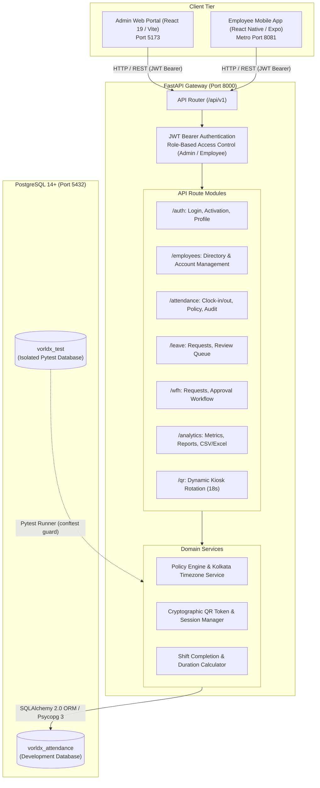

# VorldX Attendance Management System

Enterprise-grade, full-stack employee attendance tracking, policy calculation, and leave management system built for high-performance workforce operations.

---

## 1. Project Overview

The **VorldX Attendance Management System** is a unified workforce management platform engineered to eliminate manual attendance leakage, eliminate time fraud and buddy-punching, enforce organizational shift compliance, and streamline leave and remote work workflows.

### Target Users
* **Human Resources & System Administrators**: Manage employee records, monitor live attendance and presence metrics across departments, review and approve leave/WFH requests, configure working hour policies, simulate policy adjustments, inspect immutable audit trails, and export audited compliance reports.
* **Employees**: Self-service clock-in and clock-out via rotating dynamic office QR codes, real-time work-shift timer monitoring, attendance history inspection, and self-service submission of leave and Work-from-Home (WFH) requests.

### Core Problems Addressed
1. **Buddy Punching & Static QR Fraud**: Standard QR codes and manual registers allow employees to share images or clock in on behalf of absent colleagues. VorldX resolves this through **dynamic, server-rotated QR sessions** that expire every 18 seconds, validated cryptographically on the server.
2. **Ambiguous Shift & Overtime Calculations**: Built-in rules calculate punctuality (grace periods), half-day thresholds, full-day completion (minimum 8.0 qualifying hours), and overnight shift boundaries crossing midnight.
3. **Segregation of Duties & Self-Approval Prevention**: Administrators cannot approve or reject their own leave or WFH requests, guaranteeing organizational governance.
4. **Data Isolation & Privacy**: Employees have strict access only to their own attendance, leave, and WFH records; administrators maintain organization-wide oversight with audit logging on manual record corrections.

---

## 2. Key Features

| Category | Capability | Status | Implementation Details |
|---|---|---|---|
| **Authentication** | Dedicated Admin Authentication | Verified | Unique Admin ID (e.g. `ADM-001`), PBKDF2-HMAC-SHA256 hashing, stateless JWT. |
| **Authentication** | Employee Self-Activation & Login | Verified | Unique Employee ID (e.g. `VX-0101`), email uniqueness checks, account activation. |
| **Identity Separation** | Strict Portal Segregation | Verified | Admins cannot authenticate on mobile; employees cannot access administrative routes. |
| **Employee Directory** | Complete Employee Lifecycle | Verified | Create, read, update, deactivate employees. Deletion blocked if historical logs exist. |
| **Dynamic Attendance** | Rotating Kiosk QR Check-In | Verified (Backend & Web) | Kiosk displays dynamic QR rotating every 18s. Tamper-proof server validation. |
| **Attendance Flow** | Clock-in & Clock-out Lifecycle | Verified | 8.0-hour full day, 15m grace periods, 24h midnight fallback, duplicate prevention. |
| **Leave Management** | Request & Multi-Level Review | Verified | Date-range validation, pending review queue, strict self-approval prevention. |
| **WFH Management** | Remote Work Request & Review | Verified | Inactive account guards, approval logging, distinct from automatic attendance. |
| **Policy Engine** | Configurable Attendance Rules | Verified | Start/end times, late grace, half-day/full-day thresholds, atomic audit logging. |
| **Policy Simulator** | What-If Policy Calculator | Verified | Test custom shifts and timestamps against organization policy rules in real time. |
| **Analytics & Reporting** | Live Presence & Metric Cards | Verified | Active headcount, present, late, half-day, absent, on-leave, WFH, percentage. |
| **Exports** | CSV and Excel Reporting | Verified | Formula-injection sanitized (`sanitize_csv_cell`) CSV and openpyxl Excel exports. |
| **Audit Trails** | Immutable Correction Audit Logs | Verified | Captures previous/updated JSON values, admin ID, timestamp, and mandatory reason. |
| **Notifications** | Local UI Feedback & Alerts | Verified (Frontend) | React and React Native toast notifications for network, auth, and action alerts. |
| **Diagnostics & Health** | Service & Database Probes | Verified | `/health` and `/health/database` endpoints for infrastructure readiness checks. |
| **Mobile Hardware** | Physical Camera QR Scanning | Unverified (HW dependent) | Implemented via `expo-camera`; requires physical camera hardware to scan. |

---

## 3. Technology Stack

### Backend Service (`backend/`)
* **Runtime**: Python 3.10+ (Tested on Python 3.10.11)
* **Framework**: FastAPI (v0.110.0+)
* **Database ORM**: SQLAlchemy 2.0 (v2.0.28+)
* **Database Driver**: Psycopg 3 (v3.1.18+)
* **Schema Validation**: Pydantic v2 (v2.6.4+)
* **Database Migrations**: Alembic (v1.13.1+)
* **ASGI Server**: Uvicorn (v0.29.0+)
* **Testing Framework**: Pytest (v8.1.1+) & HTTPX (v0.27.0+)
* **Security & Tokens**: PyJWT (v2.8.0+), Passlib / PBKDF2-HMAC-SHA256, Cryptography (v42.0.5+)
* **Excel Reporting**: OpenPyXL (v3.1.2+)

### Administrator Web Portal (`admin-web/`)
* **Runtime**: Node.js (Active environment: `v24.18.0`, minimum required: `18.0.0+`) & npm (`v11.16.0`)
* **Framework**: React 19 (v19.2.8) & React DOM (v19.2.8)
* **Build Tool**: Vite (v8.3.0)
* **Language**: TypeScript (v6.0.2)
* **Styling**: Tailwind CSS (v4.3.3)
* **Routing**: React Router DOM (v7.18.4)
* **Icons**: Lucide React (v1.55.0)

### Employee Mobile Application (`employee-mobile/`)
* **Runtime**: Node.js (Active environment: `v24.18.0`, minimum required: `18.0.0+`) & Expo CLI
* **Framework**: React Native (v0.86.3) & Expo SDK (v~57.0.28)
* **Language**: TypeScript (v6.0.3)
* **Hardware Integrations**: Expo Camera (v~57.0.6), Expo BarCodeScanner
* **Local Storage**: `@react-native-async-storage/async-storage` (v2.2.0)
* **Component Library**: React Native Core Components with custom dark-mode theme

### Persistence Tier
* **Database**: PostgreSQL 14+ (Local service running on default port `5432`)
* **Development Database**: `vorldx_attendance` (Contains active organizational seed data)
* **Test Database**: `vorldx_test` (Isolated database strictly reserved for automated testing)

---

## 4. System Architecture



### Communication Flow
1. **Authentication**: User submits login credentials (`POST /api/v1/auth/login`). Server verifies password hash and returns signed HS256 JWT containing caller `sub` (User ID), `role` (`ADMIN` or `EMPLOYEE`), and unique identifier (`admin_id` or `employee_code`).
2. **Authorized Invocations**: Frontend clients attach the token in the `Authorization: Bearer <token>` header. FastAPI dependencies (`get_current_user`, `require_admin_user`, `require_self_or_admin`) parse and validate token claims before handler execution.
3. **Database Operations**: Handlers interact with PostgreSQL models within transactional database sessions (`get_db`), ensuring atomic commits and automatic rollbacks on integrity errors.

---

## 5. Project Directory Structure

```
vorldx-attendance/
├── README.md                           # Master repository documentation (This file)
├── admin-web/                          # Administrator Web Application
│   ├── .env.example                    # Frontend environment template
│   ├── index.html                      # Single-page application entry HTML
│   ├── package.json                    # Admin Web dependencies and scripts
│   ├── vite.config.ts                  # Vite build and dev configuration
│   └── src/
│       ├── components/                 # Shared UI (Navbar, Sidebar, Modals, Badges)
│       ├── context/                    # AuthContext and ThemeContext providers
│       ├── features/                   # Domain features (dashboard, employees, kiosk, policy)
│       ├── services/                   # Axios API service client
│       └── types/                      # TypeScript domain definitions
├── backend/                            # FastAPI Backend Service
│   ├── .env.example                    # Backend environment configuration template
│   ├── requirements.txt                # Python package manifests
│   ├── alembic.ini                     # Alembic migration configuration
│   ├── alembic/
│   │   ├── env.py                      # Migration environment configuration
│   │   └── versions/                   # Version migration scripts (6 revisions)
│   ├── app/
│   │   ├── main.py                     # Application entry point, lifespan, CORS, health probes
│   │   ├── config.py                   # Pydantic Settings configuration
│   │   ├── database.py                 # SQLAlchemy engine and SessionLocal setup
│   │   ├── api/v1/                     # API router aggregation and route controllers
│   │   ├── core/                       # JWT encoding/decoding, password hashing
│   │   ├── dependencies/               # Security dependencies (auth, database session)
│   │   ├── models/                     # SQLAlchemy declarative models (8 models)
│   │   ├── schemas/                    # Pydantic request/response schemas
│   │   └── services/                   # Business engines (policy, QR, completion)
│   ├── scripts/                        # Database management scripts (admin seeding)
│   └── tests/                          # Automated Pytest suite (188 passed tests)
├── docs/                               # Architecture, Setup, Security & Readiness Guides
│   ├── ARCHITECTURE_AND_API.md         # Comprehensive backend & endpoint documentation
│   ├── LOCAL_DEVELOPMENT_SETUP.md      # Step-by-step local workstation setup guide
│   ├── SECURITY_AND_TESTING.md         # Threat model, test results & security audit
│   ├── DEPLOYMENT_READINESS.md         # Production readiness checklist (Deployment Deferred)
│   └── DAY_14_DOCUMENTATION_READINESS_REPORT.md # Day 14 milestone execution audit
└── employee-mobile/                    # Employee Mobile Application (Expo)
    ├── App.tsx                         # Mobile root component and navigation stack
    ├── app.json                        # Expo configuration manifest
    ├── package.json                    # Mobile dependencies and scripts
    └── src/
        ├── components/                 # Mobile UI components (Header, Nav, Toast)
        ├── context/                    # Mobile AppContext (Auth, State)
        ├── screens/                    # Mobile screens (Home, Scanner, History, Requests)
        ├── services/                   # Mobile API client with network diagnostics
        └── types/                      # Mobile TypeScript definitions
```

---

## 6. Prerequisites

Before running the application locally, ensure your machine satisfies the following requirements:

| Tool | Minimum Version | Verification Command | Purpose |
|---|---|---|---|
| **Python** | 3.10+ (Verified on `3.10.11`) | `python --version` | FastAPI backend service execution |
| **Node.js** | 18.0.0+ (Verified on `v24.18.0`) | `node -v` | Admin Web and Employee Mobile bundlers |
| **npm** | 9.0.0+ (Verified on `v11.16.0`) | `npm -v` | Node package dependency management |
| **PostgreSQL** | 14.0+ (Verified on `18.6`) | `psql --version` | Relational database tier |
| **Git** | 2.30+ | `git --version` | Version control management |
| **Expo Go** (Optional) | Latest | Mobile App Store / Play Store | Testing mobile app on physical phone |

---

## 7. Local Installation and Startup

To run the full stack locally, open **three independent PowerShell terminal windows**:

### Terminal 1: Backend Service

```powershell
# Navigate to the backend directory
cd c:\Users\Rana\vorldx-attendance\backend

# Create virtual environment (if not already created)
python -m venv .venv

# Activate virtual environment
.\.venv\Scripts\Activate.ps1

# Install required Python dependencies
pip install -r requirements.txt

# Configure environment variables (ensure .env exists based on .env.example)
# Note: Keep credentials local. Never commit .env.

# Apply database migrations to current schema head
alembic upgrade head

# Start FastAPI ASGI server with auto-reload
uvicorn app.main:app --reload --host 0.0.0.0 --port 8000
```

* Backend Health Probe: `http://localhost:8000/health`
* Interactive API Documentation (Swagger): `http://localhost:8000/docs`

---

### Terminal 2: Admin Web Application

```powershell
# Navigate to the admin web directory
cd c:\Users\Rana\vorldx-attendance\admin-web

# Install npm dependencies
npm install

# Start Vite development server
npm run dev
```

* Admin Web Portal: `http://localhost:5173`

---

### Terminal 3: Employee Mobile Application

```powershell
# Navigate to the employee mobile directory
cd c:\Users\Rana\vorldx-attendance\employee-mobile

# Install npm dependencies
npm install

# Start Expo Metro Bundler
npm start
```

* Expo Metro Bundler: `http://localhost:8081`

---

## 8. Local URLs & Health Probes

| Component | Target URL | Expected Response / Purpose |
|---|---|---|
| **Backend Root** | `http://localhost:8000/` | `{"message": "VorldX Attendance API is running", "status": "success"}` |
| **Backend Health** | `http://localhost:8000/health` | `{"status": "healthy", "service": "vorldx-attendance-api", "environment": "development"}` |
| **Database Probe** | `http://localhost:8000/health/database` | `{"status": "healthy", "database": "connected"}` |
| **Swagger UI** | `http://localhost:8000/docs` | Interactive OpenAPI 3.0 documentation and testing console |
| **ReDoc Console** | `http://localhost:8000/redoc` | Alternative formatted API specification viewer |
| **Admin Web Portal** | `http://localhost:5173` | Administrator & HR web dashboard interface |
| **Metro Bundler** | `http://localhost:8081` | Expo React Native development console and QR launcher |

---

## 9. Environment Variables Reference

Environment configurations are managed via local `.env` files (referenced from `.env.example`). Secrets must remain local and are never included in frontend source code.

### Backend (`backend/.env`)
```ini
APP_NAME=VorldX Employee Attendance System
ENVIRONMENT=development
DEBUG=true
PORT=8000
ALLOWED_ORIGINS=http://localhost:5173,http://localhost:3000,http://localhost:8081

# Database Configuration (Replace with local credentials)
DATABASE_URL=postgresql+psycopg://postgres:<PASSWORD>@localhost:5432/vorldx_attendance
TEST_DATABASE_URL=postgresql+psycopg://postgres:<PASSWORD>@localhost:5432/vorldx_test

# Authentication & Security
SECRET_KEY=<SECURE_LOCAL_RANDOM_SECRET_HEX>
ALGORITHM=HS256
ACCESS_TOKEN_EXPIRE_MINUTES=60

# Organization Policy Defaults
DEFAULT_WORK_START_TIME=09:00:00
DEFAULT_WORK_END_TIME=17:00:00
DEFAULT_LATE_GRACE_MINUTES=15
DEFAULT_EARLY_DEPARTURE_GRACE_MINUTES=15
DEFAULT_HALF_DAY_HOURS=4.5
DEFAULT_FULL_DAY_HOURS=8.0
QR_CODE_EXPIRATION_SECONDS=18
ORGANIZATION_TIMEZONE=Asia/Kolkata
```

### Admin Web (`admin-web/.env`)
```ini
# Base URL for API requests
VITE_API_BASE_URL=http://localhost:8000/api/v1
```

---

## 10. Authentication and Authorization Architecture

VorldX implements a dual-credential identity architecture:
* **Administrators** authenticate with a designated **Admin ID** (e.g., `ADM-001`).
* **Employees** authenticate with their assigned **Employee ID** (e.g., `VX-0101`).
* Standard email login is explicitly blocked to prevent identity collisions and social engineering.

### Role-Based Access Control (RBAC) Matrix

| Operation | Admin Web (`ADMIN`) | Employee Mobile (`EMPLOYEE`) | Public / Anonymous |
|---|---|---|---|
| **View Organization Dashboard & Analytics** | Allowed | Denied (403) | Denied (401) |
| **View Employee Directory** | Allowed | Denied (403) | Denied (401) |
| **Create / Update Employee Records** | Allowed | Denied (403) | Denied (401) |
| **Correct Attendance Records** | Allowed (Audit Log required) | Denied (403) | Denied (401) |
| **Rotate Kiosk Dynamic QR Session** | Allowed | Denied (403) | Denied (401) |
| **Review Leave & WFH Requests** | Allowed (No self-approval) | Denied (403) | Denied (401) |
| **Clock In / Out via Dynamic QR** | Allowed (Self-record) | Allowed (Self-record) | Denied (401) |
| **View Personal Attendance History** | Allowed | Allowed (Self only) | Denied (401) |
| **Submit Leave / WFH Request** | Allowed (Self-record) | Allowed (Self only) | Denied (401) |

> [!IMPORTANT]
> Client-side route guards in React and React Native enhance user experience by hiding inaccessible controls, but **never replace server-side authorization**. Every mutating API endpoint is secured with FastAPI dependencies (`require_admin_user`, `require_self_or_admin`).

---

## 11. Attendance and Dynamic QR Lifecycle

```
[Office Kiosk Screen]                         [Employee Mobile App]                    [FastAPI Backend]
         |                                              |                                       |
         | --- (1) GET /api/v1/qr/active ------------> |                                       |
         | <--- Active Session Token (18s window) ----- |                                       |
         |                                              |                                       |
         | ===== Dynamic QR Rendered on Screen =====    |                                       |
         |                                              |                                       |
         |            (2) Employee Scans QR             |                                       |
         |            =====================>            |                                       |
         |                                              | --- (3) POST /api/v1/attendance/check-in
         |                                              |     (Bearer Token + qr_token) ------->|
         |                                              |                                       |
         |                                              |                                (4) Validate Token:
         |                                              |                                    - SHA-256 match in DB
         |                                              |                                    - Expiry check (<18s)
         |                                              |                                    - Duplicate check (date)
         |                                              |                                    - Policy evaluation
         |                                              |                                       |
         |                                              |<--- (5) 201 Created (Status / Shift) -|
```

### Shift Rules Summary
* **Full-Day Completion**: Requires a minimum of **8.0 hours worked** between check-in and check-out. Incomplete shifts receive zero credit.
* **Grace Periods**: Up to 15 minutes past start time (`09:15:00`) is classified as `PRESENT`. After 15 minutes, classified as `LATE`.
* **Overnight Shifts**: Shifts crossing midnight are supported via a 24-hour backward search window, mapping check-out events to the original shift date.

---

## 12. Automated Testing & Quality Gates

Automated tests are isolated strictly to the `vorldx_test` database. Safety guards in `backend/tests/conftest.py` ensure test fixtures never run against `vorldx_attendance`.

### Backend Test Suite
```powershell
cd c:\Users\Rana\vorldx-attendance\backend
.\.venv\Scripts\pytest.exe -v
```
* **Execution Baseline**: 188 passed, 1 skipped, 0 failures (28.38s execution time).

### Admin Web Lint & Build
```powershell
cd c:\Users\Rana\vorldx-attendance\admin-web
npm run lint          # Validates ESLint rules
npm run build         # Validates TypeScript compilation and production bundle
```

### Employee Mobile Type Check
```powershell
cd c:\Users\Rana\vorldx-attendance\employee-mobile
npx tsc --noEmit      # Validates TypeScript typings across all screens and services
```

---

## 13. Troubleshooting Guide

### 1. PostgreSQL Connection Failure
* **Symptom**: `psycopg.OperationalError: connection to server at "localhost", port 5432 failed`.
* **Resolution**: Ensure the PostgreSQL service is active. In Windows PowerShell:
  ```powershell
  Get-Service -Name postgresql* | Start-Service
  ```
  Verify that both `vorldx_attendance` and `vorldx_test` databases exist in `psql`.

### 2. Backend Port 8000 Conflict
* **Symptom**: `ERROR: [Errno 10048] error while attempting to bind on address ('0.0.0.0', 8000)`.
* **Resolution**: Check for existing Python/Uvicorn processes:
  ```powershell
  Get-Process -Name python, uvicorn -ErrorAction SilentlyContinue | Stop-Process -Force
  ```

### 3. Mobile App Unable to Reach Laptop Backend
* **Symptom**: Network request failed when scanning QR or logging in from physical phone.
* **Resolution**: `localhost` on a mobile phone resolves to the phone itself. Use your workstation's local private IP address (e.g. `http://192.168.1.50:8000/api/v1`) in the mobile network settings screen. Ensure Windows Firewall permits incoming TCP traffic on port 8000 for private networks.

### 4. Admin Web API Connection Error
* **Symptom**: `AxiosError: Network Error` in browser console.
* **Resolution**: Verify that the backend is running (`curl http://localhost:8000/health`) and that `VITE_API_BASE_URL` in `admin-web/.env` is set to `http://localhost:8000/api/v1`.
