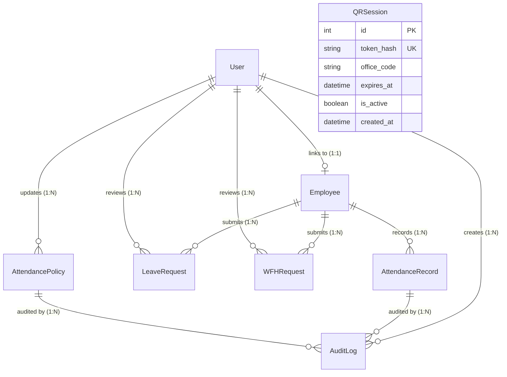

# VorldX Backend Architecture and API Specification

This document provides a comprehensive technical reference for the FastAPI backend service of the **VorldX Attendance Management System**. It covers the system architecture, startup lifecycle, database modeling, authentication and authorization pipelines, business domain services, and an exhaustive inventory of all API endpoints.

---

## 1. System Architecture Overview

The VorldX backend is engineered as an asynchronous, modular REST service using **FastAPI**, **SQLAlchemy 2.0**, and **PostgreSQL 14+**. It is designed with clean architectural boundaries separating transport, domain logic, and data persistence:

```
[ HTTP Clients: Admin Web / Employee Mobile ]
                      │
                      ▼
            [ FastAPI ASGI Engine ]
                      │
        ┌─────────────┴─────────────┐
        ▼                           ▼
[ Security & CORS ]       [ OpenAPI /docs ]
        │
        ▼
[ API v1 Router: /api/v1 ]
        │
        ├── /auth        ───► [ Auth Controller ]
        ├── /employees   ───► [ Employee Controller ]
        ├── /attendance  ───► [ Attendance & Policy Controller ]
        ├── /leave       ───► [ Leave Request Controller ]
        ├── /wfh         ───► [ Remote Work Controller ]
        ├── /analytics   ───► [ Dashboard & Export Controller ]
        └── /qr          ───► [ Dynamic QR Controller ]
                      │
                      ▼
            [ Domain Service Layer ]
        ├── Policy Engine (calculate_check_in_status, calculate_check_out_status)
        ├── Dynamic QR Service (token generation, SHA-256 hashing, 18s expiry)
        └── Shift Completion Engine (8.0h full-day threshold, overnight fallback)
                      │
                      ▼
          [ SQLAlchemy 2.0 ORM Tier ]
        ├── Declarative Models (User, Employee, AttendanceRecord, etc.)
        └── Unit-of-Work Session Management (get_db dependency)
                      │
                      ▼
             [ PostgreSQL 14+ ]
```

---

## 2. Application Startup & Lifespan Flow

The backend entry point is located in `backend/app/main.py`. The service leverages modern asynchronous lifespan management (`@asynccontextmanager`):

### Startup Sequence (`lifespan`)
1. **Logging Initialization**: Configures application-level loggers (`vorldx.app`) with structured time, severity level, and module information.
2. **Environment & Connection Log**: Emits initialization telemetry, printing the active environment mode and a masked database connection string (`masked_database_url` masks passwords).
3. **CORS Middleware Configuration**:
   - In production, restricts origins to explicitly configured whitelists (`settings.allowed_origins`).
   - In development, permits local development clients across standard loopback addresses and private Local Area Network (LAN) subnets via regular expression matching:
     ```regex
     ^https?://(localhost|127\.0\.0\.1|192\.168\.\d+\.\d+|10\.\d+\.\d+\.\d+|172\.(1[6-9]|2\d|3[0-1])\.\d+\.\d+)(:\d+)?$
     ```
4. **Router Registration**: Mounts the aggregated `api_v1_router` under the `/api/v1` prefix.
5. **Infrastructure Probes**: Registers `/` (root service banner), `/health` (service readiness), and `/health/database` (live database connectivity test).

### Teardown Sequence
On application termination (SIGINT/SIGTERM), the lifespan context manager executes `engine.dispose()`, cleanly closing and releasing all pooled PostgreSQL connections.

---

## 3. Database Architecture & Model Relationships

The persistence layer is modeled with SQLAlchemy 2.0 declarative syntax in `backend/app/models/`.



### Entity Model Definitions

#### 1. `User` (`users` table)
Represents authentication credentials and role authorization.
* `id`: Integer Primary Key.
* `email`: Unique string identifier for account communications.
* `password_hash`: Salted PBKDF2-HMAC-SHA256 password hash.
* `role`: Enum (`ADMIN`, `EMPLOYEE`).
* `admin_id`: Unique nullable string (e.g., `ADM-001`). Enforced unique across administrators.
* `is_active`: Boolean flag controlling account login eligibility.
* `employee`: One-to-one relationship to `Employee`.

#### 2. `Employee` (`employees` table)
Represents the organizational workforce record.
* `id`: Integer Primary Key.
* `employee_code`: Unique organizational ID (e.g., `VX-0101`).
* `full_name`: Employee's legal name.
* `department`: Organizational department (e.g. Engineering, Sales, HR).
* `designation`: Job title or role.
* `user_id`: Nullable Foreign Key referencing `users.id` (links credentials upon activation).

#### 3. `AttendanceRecord` (`attendance_records` table)
Tracks daily work attendance, clock-in, and clock-out timestamps.
* `id`: Integer Primary Key.
* `employee_id`: Foreign Key referencing `employees.id`.
* `attendance_date`: Calendar date of attendance in organization local time (`Asia/Kolkata`).
* `check_in`: Timezone-aware UTC timestamp of clock-in.
* `check_out`: Timezone-aware UTC timestamp of clock-out (nullable while shift is active).
* `status`: Enum (`PRESENT`, `LATE`, `HALF_DAY`, `ABSENT`).
* `source`: Metadata tracking clock-in mechanism (e.g., `DYNAMIC_QR_HQ_MAIN`).
* `is_corrected`: Boolean flag indicating whether the record was modified by an admin.
* `corrected_by`: Nullable Foreign Key referencing `users.id`.
* *Constraint*: Unique constraint on `(employee_id, attendance_date)`. Prevents duplicate attendance entries on the same date.

#### 4. `AttendancePolicy` (`attendance_policies` table)
Defines working hour rules and threshold calculations.
* `id`: Integer Primary Key.
* `policy_name`: Identifier (default: `Default Policy`).
* `work_start_time`: Time of expected shift commencement (default: `09:00:00`).
* `work_end_time`: Time of expected shift conclusion (default: `17:00:00`).
* `late_grace_minutes`: Grace period before arrival is marked late (default: `15`).
* `early_departure_grace_minutes`: Grace period for leaving before end time (default: `15`).
* `half_day_hours_threshold`: Minimum hours required for half-day credit (default: `4.5`).
* `full_day_hours_threshold`: Minimum hours required for full-day credit (default: `8.0`).
* `is_active`: Boolean indicating active status.
* `updated_by`: Foreign Key referencing `users.id`.

#### 5. `AuditLog` (`audit_logs` table)
Immutable audit trail capturing administrative modifications.
* `id`: Integer Primary Key.
* `admin_id`: Foreign Key referencing `users.id`.
* `action_type`: Category of administrative action (`ATTENDANCE_CORRECTION`, `POLICY_UPDATE`).
* `employee_id`: Nullable Foreign Key referencing `employees.id`.
* `attendance_record_id`: Nullable Foreign Key referencing `attendance_records.id`.
* `policy_id`: Nullable Foreign Key referencing `attendance_policies.id`.
* `reason`: Mandatory text description explaining why the modification was performed.
* `previous_values`: JSON string storing entity state before modification.
* `updated_values`: JSON string storing entity state after modification.
* `created_at`: Timezone-aware UTC creation timestamp.

#### 6. `LeaveRequest` (`leave_requests` table)
* `id`: Integer Primary Key.
* `employee_id`: Foreign Key referencing `employees.id`.
* `start_date`: Inclusive calendar start date.
* `end_date`: Inclusive calendar end date (`end_date >= start_date`).
* `reason`: Employee justification for time off.
* `status`: Enum (`PENDING`, `APPROVED`, `REJECTED`).
* `reviewed_by`: Nullable Foreign Key referencing `users.id`.
* `reviewed_at`: Nullable timestamp of administrator review.

#### 7. `WFHRequest` (`wfh_requests` table)
* `id`: Integer Primary Key.
* `employee_id`: Foreign Key referencing `employees.id`.
* `start_date`: Inclusive calendar start date.
* `end_date`: Inclusive calendar end date (`end_date >= start_date`).
* `reason`: Employee justification for remote work.
* `status`: Enum (`PENDING`, `APPROVED`, `REJECTED`).
* `reviewed_by`: Nullable Foreign Key referencing `users.id`.
* `reviewed_at`: Nullable timestamp of administrator review.

#### 8. `QRSession` (`qr_sessions` table)
* `id`: Integer Primary Key.
* `token_hash`: Unique SHA-256 hash of the issued dynamic token string.
* `office_code`: Location identifier (e.g. `HQ_MAIN`).
* `expires_at`: Expiration timestamp (created_at + 18 seconds).
* `is_active`: Boolean status.
* `created_at`: Creation timestamp.

---

## 4. Database Session and Transaction Management

FastAPI routes obtain database access via the `get_db` dependency in `backend/app/dependencies/database.py`:
```python
def get_db():
    db = SessionLocal()
    try:
        yield db
    finally:
        db.close()
```
* **Transactional Boundaries**: Mutating operations call `db.commit()` on success. Any unhandled exception propagates to FastAPI error handlers while the `finally` block ensures the session is returned to the pool.
* **Concurrency Locking**: Critical operations (such as clock-out lookup) utilize `select(...).with_for_update()` to prevent race conditions during simultaneous client invocations.
* **Integrity Handling**: Database constraint violations (`IntegrityError`) are trapped and translated into appropriate HTTP status codes (such as `409 Conflict` for duplicate check-ins or unique key collisions).

---

## 5. Alembic Database Migrations

Database schema versions are managed via Alembic in `backend/alembic/`.

### Migration History
1. `dd512940ae96`: Initial schema defining `users`, `employees`, `attendance_records`, and `leave_requests`.
2. `5c196f366ac6`: Add unique `admin_id` column to `users` for administrator authentication.
3. `fcded48d3cd4`: Create `attendance_policies` table.
4. `e85f4019b7a1`: Add `is_corrected`, `corrected_at`, `corrected_by` to attendance records and create `audit_logs` table.
5. `d77322e04cb6`: Create `qr_sessions` table with SHA-256 token hashing and 18-second expiration.
6. `8131b0947487`: Create `wfh_requests` table (Current Migration Head).

### Migration Commands
* Apply latest migrations:
  ```powershell
  alembic upgrade head
  ```
* Roll back one migration:
  ```powershell
  alembic downgrade -1
  ```
* View migration history:
  ```powershell
  alembic history --verbose
  ```

---

## 6. Authentication & Authorization Flow

### Password Security & Credentials
* Passwords are encrypted using **PBKDF2-HMAC-SHA256** with 100,000 hashing iterations and an isolated 16-byte random salt.
* Plaintext passwords are never logged, stored, or exposed.

### Identity Segregation
* **Admin Login**: Requires matching `admin_id` (e.g. `ADM-001`) and `role == UserRole.ADMIN`.
* **Employee Login**: Requires matching `employee_code` (e.g. `VX-0101`) through the linked `Employee` record.
* Email addresses are explicitly rejected as login identifiers to prevent account takeover and credential stuffing.

### Token Architecture
* Authentication issues a stateless **JWT (JSON Web Token)** using the **HS256** algorithm.
* **Expiry**: Configured to 60 minutes (`ACCESS_TOKEN_EXPIRE_MINUTES = 60`).
* **Claims**:
  * `sub`: Subject identifier (stringified integer `User.id`).
  * `role`: User role (`admin` or `employee`).
  * `admin_id`: Populated for administrators.
  * `employee_id` / `employee_code`: Populated for employees.
  * `exp`: Standard Unix expiration timestamp.

### Security Dependencies
* `get_current_user`: Validates JWT signature, checks expiration, loads user from database, and verifies `is_active == True`.
* `require_admin_user`: Enforces `current_user.role == UserRole.ADMIN`. Returns `403 Forbidden` for employees.
* `require_self_or_admin(target_employee_id, current_user)`: Allows administrators to act universally, but restricts employees strictly to actions on their own `employee_id`.

---

## 7. Dynamic QR Attendance Lifecycle

```
[ Kiosk Terminal ]                     [ Backend Server ]                   [ Employee Mobile ]
        │                                      │                                     │
        │─── GET /api/v1/qr/active ───────────►│                                     │
        │    (Admin Bearer Token)              │                                     │
        │                                      ├─ Check Active Session               │
        │                                      ├─ If expired/missing:                │
        │                                      │   Create 64-char hex token          │
        │                                      │   Store SHA-256 hash in DB          │
        │                                      │   Set expires_at = now + 18s        │
        │◄── Return Session + Token ───────────┤                                     │
        │                                                                            │
        │== Render Dynamic QR Code ==                                                │
        │   Payload: "VXQR:v1:{office}:{token}"                                      │
        │                                                                            │
        │                                      (Employee scans code)                 │
        │                                                                            │
        │                                      │◄── POST /api/v1/attendance/check-in ┤
        │                                      │    (Bearer + qr_token)              │
        │                                      │                                     │
        │                                      ├─ Hash submitted token with SHA-256  │
        │                                      ├─ Lookup hash in qr_sessions         │
        │                                      ├─ Verify expires_at > now_utc        │
        │                                      ├─ Verify office_code matches         │
        │                                      ├─ Check duplicate check-in today     │
        │                                      ├─ Evaluate punctuality vs Policy     │
        │                                      ├─ Insert AttendanceRecord            │
        │                                      │                                     │
        │                                      ├────────────────────────────────────►│
        │                                      │    201 Created (Attendance Record)  │
```

1. **Short Expiration Window**: QR sessions expire strictly after **18 seconds** (`QR_CODE_EXPIRATION_SECONDS = 18`). Static photos or forwarded screenshots expire before unauthorized use.
2. **Tamper-Proof Storage**: The database stores only the SHA-256 hash of the issued token. Raw tokens cannot be extracted from database dumps.
3. **Multi-Employee Concurrency**: Multiple legitimate employees standing at the kiosk may scan the same active QR token within its 18-second lifetime.
4. **Duplicate Prevention**: The backend verifies that the scanning employee has not already clocked in for the current organization date (`409 Conflict`).

---

## 8. Shift Evaluation & Attendance Completion Engine

Attendance calculation is handled by `backend/app/services/attendance_completion_service.py` and `backend/app/services/policy_service.py`.

### 1. Clock-in Evaluation (`calculate_check_in_status`)
* Converts timestamp to organization time (`Asia/Kolkata`).
* Compares time against `policy.work_start_time` (e.g., `09:00:00`):
  * **On Time**: Within `work_start_time + late_grace_minutes` (e.g., $\le$ `09:15:00`). Classified as `PRESENT`.
  * **Late Arrival**: After `09:15:00`. Classified as `LATE`.

### 2. Clock-out Evaluation (`evaluate_record_completion`)
* Computes duration worked in decimal hours:
  $$\text{Hours Worked} = \frac{\text{Check Out} - \text{Check In}}{3600}$$
* Applies full-day threshold rules:
  * **Qualifying Full Day**: Requires $\text{Hours Worked} \ge \text{policy.full_day_hours_threshold}$ (minimum **8.0 hours**). Status remains `PRESENT` or `LATE`.
  * **Half Day**: If $\text{Hours Worked} \ge 4.5$ but $< 8.0$. Status becomes `HALF_DAY`.
  * **Incomplete / Short Shift**: If $\text{Hours Worked} < 4.5$. Status remains marked with zero credit.

### 3. Overnight Shift Fallback
For shifts beginning late in the evening and ending after local midnight, the check-out algorithm searches backward across a 24-hour window for the employee's open check-in record, accurately associating the check-out with the originating shift date.

---

## 9. Comprehensive API Endpoint Inventory

The backend exposes **41 distinct endpoints** grouped into 7 functional subrouters mounted under `/api/v1`, plus root infrastructure probes.

### Root & Health Endpoints

| Method | Endpoint | Description | Auth Requirement | Required Role |
|---|---|---|---|---|
| `GET` | `/` | Service identification and greeting banner | None (Public) | None |
| `GET` | `/health` | Application status probe | None (Public) | None |
| `GET` | `/health/database` | Database connection live test probe | None (Public) | None |

### Authentication Subrouter (`/api/v1/auth`)

| Method | Endpoint | Description | Auth Requirement | Required Role |
|---|---|---|---|---|
| `GET` | `/api/v1/auth/status` | Authentication service readiness probe | None (Public) | None |
| `POST` | `/api/v1/auth/login` | Authenticate using Admin ID or Employee ID | None (Public) | None |
| `GET` | `/api/v1/auth/me` | Retrieve profile and identity of current user | Bearer Token | Authenticated User |
| `POST` | `/api/v1/auth/activate` | Employee self-activation and password setup | None (Public) | None |

### Employee Directory Subrouter (`/api/v1/employees`)

| Method | Endpoint | Description | Auth Requirement | Required Role |
|---|---|---|---|---|
| `GET` | `/api/v1/employees` | List employees with department filter and pagination | Optional Bearer | Any Caller |
| `POST` | `/api/v1/employees` | Create a new employee record | Optional Bearer | `ADMIN` (if token provided) |
| `GET` | `/api/v1/employees/{employee_id}` | Retrieve single employee details by ID | None | Any Caller |
| `PUT` | `/api/v1/employees/{employee_id}` | Update employee profile fields | Optional Bearer | `ADMIN` (if token provided) |
| `DELETE` | `/api/v1/employees/{employee_id}` | Delete employee (blocked if records exist) | Optional Bearer | `ADMIN` (if token provided) |
| `POST` | `/api/v1/employees/{employee_id}/account` | Provision or reset employee credentials | Bearer Token | `ADMIN` |
| `PATCH` | `/api/v1/employees/{employee_id}/status` | Activate or deactivate employee user account | Bearer Token | `ADMIN` |

### Attendance Subrouter (`/api/v1/attendance`)

| Method | Endpoint | Description | Auth Requirement | Required Role |
|---|---|---|---|---|
| `GET` | `/api/v1/attendance/dashboard` | Employee attendance dashboard & KPI statistics | Bearer Token | `EMPLOYEE` (self) or `ADMIN` |
| `GET` | `/api/v1/attendance/stats` | Alias for attendance dashboard statistics | Bearer Token | `EMPLOYEE` (self) or `ADMIN` |
| `GET` | `/api/v1/attendance` | Query attendance records with date/status filters | Bearer Token | `EMPLOYEE` (self) or `ADMIN` (all) |
| `POST` | `/api/v1/attendance/check-in` | Record clock-in event (manual or dynamic QR) | Optional Bearer | Self or `ADMIN` |
| `POST` | `/api/v1/attendance/check-out` | Record clock-out event and calculate duration | Optional Bearer | Self or `ADMIN` |
| `GET` | `/api/v1/attendance/policy` | Retrieve active organization attendance policy | None (Public) | None |
| `PUT` | `/api/v1/attendance/policy` | Update attendance policy (creates audit log) | Bearer Token | `ADMIN` |
| `POST` | `/api/v1/attendance/policy/calculate` | Simulate policy calculations for check-in/out | None (Public) | None |
| `PATCH` | `/api/v1/attendance/{record_id}/correct` | Correct attendance record (creates audit log) | Bearer Token | `ADMIN` |
| `GET` | `/api/v1/attendance/audit-logs` | Retrieve audit trail of corrections and changes | Bearer Token | `ADMIN` |

### Leave Management Subrouter (`/api/v1/leave`)

| Method | Endpoint | Description | Auth Requirement | Required Role |
|---|---|---|---|---|
| `GET` | `/api/v1/leave` | List leave requests with status/employee filters | Optional Bearer | `EMPLOYEE` (self) or `ADMIN` (all) |
| `POST` | `/api/v1/leave` | Submit a new leave request | Optional Bearer | Self or `ADMIN` |
| `PATCH` | `/api/v1/leave/{leave_id}/review` | Approve or reject leave (anti-self-approval) | Bearer Token | `ADMIN` |

### Work-From-Home Subrouter (`/api/v1/wfh`)

| Method | Endpoint | Description | Auth Requirement | Required Role |
|---|---|---|---|---|
| `GET` | `/api/v1/wfh` | List WFH requests with status/employee filters | Bearer Token | `EMPLOYEE` (self) or `ADMIN` (all) |
| `POST` | `/api/v1/wfh` | Submit a remote work request | Bearer Token | `EMPLOYEE` (self) or `ADMIN` |
| `PATCH` | `/api/v1/wfh/{wfh_id}/review` | Approve or reject WFH (anti-self-approval) | Bearer Token | `ADMIN` |

### Analytics & Reports Subrouter (`/api/v1/analytics`)

| Method | Endpoint | Description | Auth Requirement | Required Role |
|---|---|---|---|---|
| `GET` | `/api/v1/analytics/dashboard` | Real-time executive dashboard KPIs for date | Bearer Token | `ADMIN` |
| `GET` | `/api/v1/analytics/metrics` | Alias for dashboard metrics endpoint | Bearer Token | `ADMIN` |
| `GET` | `/api/v1/analytics/daily` | Comprehensive daily attendance breakdown | Bearer Token | `ADMIN` |
| `GET` | `/api/v1/analytics/late-report` | Late arrivals report with delay durations | Bearer Token | `ADMIN` |
| `GET` | `/api/v1/analytics/wfh-report` | Remote work distribution and headcount report | Bearer Token | `ADMIN` |
| `GET` | `/api/v1/analytics/export/attendance.csv` | Export attendance data as sanitized CSV file | Bearer Token | `ADMIN` |
| `GET` | `/api/v1/analytics/export/attendance.xlsx`| Export attendance data as formatted Excel file | Bearer Token | `ADMIN` |
| `GET` | `/api/v1/analytics/summary` | Multi-day attendance summary and trends | Bearer Token | `ADMIN` |
| `GET` | `/api/v1/analytics/trends` | Historical daily attendance trend analysis | Bearer Token | `ADMIN` |

### Dynamic QR Kiosk Subrouter (`/api/v1/qr`)

| Method | Endpoint | Description | Auth Requirement | Required Role |
|---|---|---|---|---|
| `GET` | `/api/v1/qr/active` | Get active kiosk QR session (auto-rotates) | Bearer Token | `ADMIN` |
| `POST` | `/api/v1/qr/rotate` | Force immediate rotation of kiosk QR session | Bearer Token | `ADMIN` |

---

## 10. Local API Documentation & Exploration

When running locally in development mode, FastAPI automatically generates interactive documentation:
* **Swagger UI**: Accessible at `http://localhost:8000/docs`. Allows testing endpoints directly in the browser by clicking **Authorize** and supplying an administrator or employee JWT token.
* **ReDoc**: Accessible at `http://localhost:8000/redoc`. Provides a clean, publication-grade representation of schemas, query parameters, and responses.
* **Raw OpenAPI Specification**: Accessible at `http://localhost:8000/openapi.json`.
